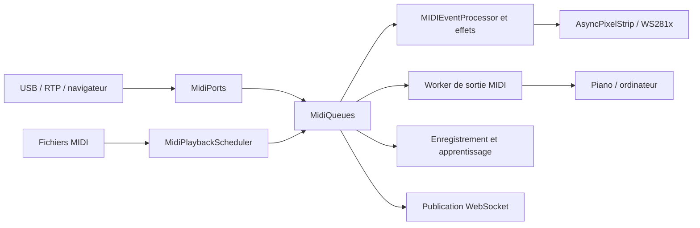

# Architecture

Le visualiseur fonctionne dans un processus Python, lancé par
[`visualizer.py`](../visualizer.py). `VisualizerApp` initialise les composants,
coordonne le rendu et arrête les ressources. Sur le Pi, systemd lance ce
processus avec le service `visualizer.service`.

## Flux MIDI et LED

La réception, le rendu, la retransmission et la publication web consomment des
files distinctes : un consommateur ne doit pas retirer les événements destinés
aux autres. Sur Linux/ALSA, `BufferedMidiInput` utilise une file native avant le
traitement Python. Les autres backends conservent l'entrée Mido.

| Emplacement | Responsabilité |
| --- | --- |
| [`lib/component_initializer.py`](../lib/component_initializer.py) | Création et branchement des composants |
| [`lib/midiports.py`](../lib/midiports.py), [`lib/midi_queues.py`](../lib/midi_queues.py) | Ports, connexions et répartition des messages |
| [`lib/midi_playback_scheduler.py`](../lib/midi_playback_scheduler.py) | Échéances et annulation de la lecture MIDI |
| [`lib/midi_event_processor.py`](../lib/midi_event_processor.py), [`lib/led_effects_processor.py`](../lib/led_effects_processor.py) | Traitement des notes et rendu des effets |
| [`lib/async_strip.py`](../lib/async_strip.py) | Transmission des frames au pilote LED |
| [`lib/ledsettings.py`](../lib/ledsettings.py), [`lib/functions.py`](../lib/functions.py) | Réglages, mapping des touches et animations |
| [`lib/usersettings.py`](../lib/usersettings.py), [`lib/state_manager.py`](../lib/state_manager.py) | Réglages persistants et état d'activité |
| [`lib/menulcd.py`](../lib/menulcd.py), [`lib/gpio_handler.py`](../lib/gpio_handler.py) | Commandes locales, écran et boutons |
| [`webinterface/`](../webinterface/) | Flask/Waitress, pages web et serveur WebSocket sur le port 8765 |

Les routes HTTP et les gestionnaires WebSocket accèdent aux composants via
`webinterface.app_state`. Le rendu doit rester indépendant de la vitesse des
clients web. Le LCD et l'interface web contrôlent les mêmes réglages.

## Apprentissage

Deux chemins sont disponibles :

- **Morceau local** : `LearnMIDI` charge le fichier et guide les touches à jouer.
  Le tempo suit les événements MIDI ; les délais utilisent une horloge monotone.
  Son cache JSON est facultatif, validé et lié au fichier source.
- **Synthesia Learning bridge** : `LearningBridge` ouvre deux entrées et deux
  sorties explicites. `LearningSession` distingue le piano du guide ordinateur ;
  les workers `LearningOutput` possèdent leurs sorties. Les notes de guide ont
  leur propre file de rendu. La lecture et la pratique locales ont priorité sur
  ce guide. Voir la [configuration Synthesia](features.md#learning_with_synthesia).

Pour les morceaux locaux, les deux premières pistes contenant des notes sont
les rôles droite et gauche ; les pistes de conducteur ne comptent pas. Avec une
seule piste jouable, les deux premiers canaux de notes portent ces rôles. Les
parties supplémentaires accompagnent le joueur. Ces rôles sont des métadonnées :
les canaux MIDI d'origine sont conservés à la sortie. Le score utilise
l'horodatage monotone de l'entrée, compte chaque hauteur une fois par accord et
attribue les résultats aux rôles du morceau. Une faute est rapprochée de la note
attendue la plus proche ; le logiciel ne mesure pas la main physique du joueur.

Le pilote LED compose des frames publiées atomiquement : notes, sustain et
effets actifs ont priorité sur les vues d'apprentissage et d'aperçu, puis sur
les animations. Chaque vue possède ses pixels et libère sa couche à la sortie.
Changer le fond ne supprime pas les notes actives. `Disabled` efface l'état
musical, impose le noir et invalide les anciennes frames et vues.

## Ressources et arrêt

Les callbacks d'entrée passent les messages aux files ; les sorties natives et
le rendu sont exécutés par leurs workers. Les réglages et les diagnostics
possèdent leurs propres verrous. Ne pas attendre un thread en conservant un
verrou dont il a besoin pour sortir.

Un timeout n'autorise pas à fermer un port ou le DMA encore utilisé : leur
propriétaire conserve la ressource jusqu'à son arrêt effectif. Le serveur
WebSocket annule sa tâche propriétaire dans sa boucle, ferme ses connexions
et attend ses tâches avant de fermer cette boucle.

La fermeture MIDI attend au plus le budget demandé puis signale un nettoyage
incomplet. Un worker propriétaire conserve les handles et effectue les appels
natifs ; aucune réouverture ne les remplace avant sa fin. Un thread bloqué dans
un pilote natif ne peut pas être tué proprement depuis Python. La panique MIDI
peut être demandée sans bloquer ; une nouvelle session d'apprentissage attend
sa fin pour ne pas recevoir une ancienne panique après ses premières notes.

Ce budget suppose que le backend permet aux autres threads Python de progresser.
Il n'est pas une garantie absolue si un pilote bloque en conservant le GIL :
les wrappers de fermeture et d'envoi de
[python-rtmidi 1.5.8](https://github.com/SpotlightKid/python-rtmidi/blob/1.5.8/src/_rtmidi.pyx)
ne garantissent pas sa libération. Isoler les ports dans un autre processus
serait nécessaire pour couvrir aussi ce cas. L'application conserve les GPIO
si le pilote LED refuse de confirmer son arrêt et signale les nettoyages
incomplets au lieu d'annoncer que les ressources sont déjà libérées.

Les morceaux et partitions sont dans `Songs/`, les réglages dans
`config/settings.xml`. Le programme de mise à jour indépendant sauvegarde les
données, valide la version, redémarre le service et contrôle `/api/health`.
Les instructions sont dans le [guide d'installation](manual_installation.md) ;
les méthodes de mesure et leurs limites dans le [guide de performance](performance.md).
