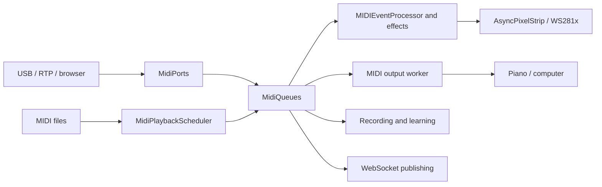

# Architecture

The visualizer runs in a single Python process, started by
[`visualizer.py`](../visualizer.py). `VisualizerApp` initializes the components,
coordinates rendering and shuts down resources. On the Pi, systemd starts this
process through `visualizer.service`.

## MIDI and LED flow

Input handling, rendering, forwarding and web publishing consume separate
queues: one consumer must not remove events intended for another. On
Linux/ALSA, `BufferedMidiInput` uses a native queue before Python processing.
Other backends retain the Mido input path.

| Location | Responsibility |
| --- | --- |
| [`lib/component_initializer.py`](../lib/component_initializer.py) | Component creation and wiring |
| [`lib/midiports.py`](../lib/midiports.py), [`lib/midi_queues.py`](../lib/midi_queues.py) | Ports, connections and message distribution |
| [`lib/midi_playback_scheduler.py`](../lib/midi_playback_scheduler.py) | MIDI playback deadlines and cancellation |
| [`lib/midi_event_processor.py`](../lib/midi_event_processor.py), [`lib/led_effects_processor.py`](../lib/led_effects_processor.py) | Note processing and effect rendering |
| [`lib/async_strip.py`](../lib/async_strip.py) | Frame transmission to the LED driver |
| [`lib/ledsettings.py`](../lib/ledsettings.py), [`lib/functions.py`](../lib/functions.py) | Settings, key mapping and animations |
| [`lib/usersettings.py`](../lib/usersettings.py), [`lib/state_manager.py`](../lib/state_manager.py) | Persistent settings and activity state |
| [`lib/menulcd.py`](../lib/menulcd.py), [`lib/gpio_handler.py`](../lib/gpio_handler.py) | Local controls, display and buttons |
| [`webinterface/`](../webinterface/) | Flask/Waitress, web pages and the WebSocket server on port 8765 |

HTTP routes and WebSocket handlers access components through
`webinterface.app_state`. Rendering must remain independent of web client
speed. The LCD and the web interface control the same settings.

## Learning

Two paths are available:

- **Local song**: `LearnMIDI` loads the file and highlights the keys to play.
  Tempo follows MIDI events; delays use a monotonic clock. Its JSON cache is
  optional, validated and tied to the source file.
- **Synthesia Learning bridge**: `LearningBridge` opens two explicit inputs and
  two explicit outputs. `LearningSession` distinguishes the piano from the
  computer guide; `LearningOutput` workers own their outputs. Guide notes have
  their own rendering queue. Local playback and practice take priority over
  this guide. See the [Synthesia setup](features.md#learning_with_synthesia).

For local songs, the first two tracks containing notes are assigned the right
and left hand roles; conductor tracks do not count. With a single playable
track, its first two note channels carry these roles. Additional parts accompany
the player. These roles are metadata: the original MIDI channels are preserved
at the output. Scoring uses the input's monotonic timestamp, counts each pitch
once per chord and assigns results to the song's roles. A wrong note is matched
to the nearest expected note; the software does not detect which physical hand
the player used.

The LED driver composes atomically published frames: notes, sustain and active
effects take priority over learning and preview views, which take priority over
animations. Each view owns its pixels and releases its layer when it exits.
Changing the background does not remove active notes. `Disabled` clears the
musical state, forces the output to black and invalidates old frames and views.

## Resources and shutdown

Input callbacks pass messages to queues; native output and rendering run in
their own workers. Settings and diagnostics have their own locks. Do not wait
for a thread while holding a lock that it needs to exit.

A timeout does not authorize closing a port or DMA resource that is still in
use: its owner retains it until it has actually stopped. The WebSocket server
cancels its owner task within its event loop, closes its connections and waits
for its tasks before closing that loop.

MIDI shutdown waits for at most the requested time budget, then reports
incomplete cleanup. An owner worker retains the handles and makes native calls;
reopening does not replace them before it finishes. Python cannot cleanly kill
a thread stuck in a native driver. A MIDI panic can be requested without
blocking; a new learning session waits for it to finish so that a previous
panic cannot arrive after the session's first notes.

This budget assumes that the backend allows other Python threads to make
progress. It is not an absolute guarantee if a driver blocks while holding the
GIL: the close and send wrappers in
[python-rtmidi 1.5.8](https://github.com/SpotlightKid/python-rtmidi/blob/1.5.8/src/_rtmidi.pyx)
do not guarantee its release. Isolating ports in another process would be
necessary to cover that case as well. The application retains GPIO resources
if the LED driver does not confirm shutdown and reports incomplete cleanup
rather than claiming that resources have already been released.

Songs and sheet music are stored in `Songs/`, and settings in
`config/settings.xml`. The independent updater backs up data, validates the
version, restarts the service and checks `/api/health`. Instructions are in the
[installation guide](manual_installation.md); measurement methods and their
limits are in the [performance guide](performance.md).
