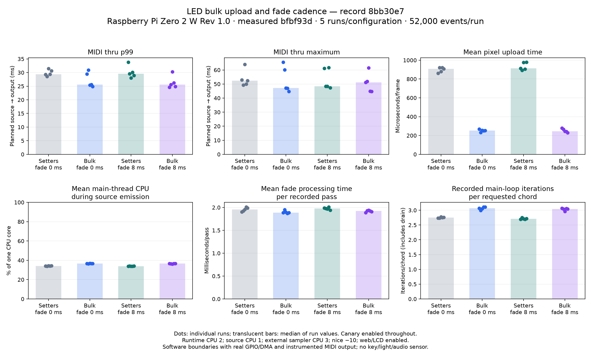

# LED bulk upload and fade cadence — record 8bb30e7

## Acquisition and scope

Record version: `8bb30e7`. This commit publishes the measurements and changes
only documentation and the plotting tool; its runtime and benchmark sources
are unchanged from the tested revision below.

Measured on Pi Zero 2 W Rev 1.0 at runtime revision `bfbf93d28009b8fd30cd065f56744f8222129eea`,
including `656ec43` and the scheduler-sampling correction `bfbf93d`.
Acquisition: `2026-11-15T09:23:12.798700+00:00` to `2026-11-15T09:49:56.451607+00:00`.
Kernel `6.12.109+rpt-rpi-v7`, Python 3.11.2, rpi-ws281x 5.0.0, 195 LEDs.
The [JSON dataset](pipeline_8bb30e7.json) contains per-run benchmark timings,
counters, GC records and CPU samples, with instrumentation source hashes.
The [compressed stall archive](pipeline_8bb30e7_stalls.json.gz) contains all
retained canary records, indexed by run name, including scheduler samples.
Port identities and ALSA client listings are omitted; full logs remain local.

All configurations use this same revised independent-source benchmark. These
are software timings through virtual ALSA and the production MIDI/render path,
with real GPIO/DMA and an instrumented output that does not play a piano.
There is no key, photodiode or audio sensor. Network delivery and physical
key-to-light/key-to-sound latency have not been remeasured.

The runtime uses CPU 2, the independent source CPU 1, and an external CPU sampler
CPU 3. Both benchmark processes use nice −10; web and platform/LCD mode are
enabled, without generated browser/WebSocket traffic. Fading mode is selected
in memory. The chord profile is 2,000 twelve-note chords, with pedal events,
20 ms absolute deadlines and 52,000 measured events per run. Seed is 1;
cProfile is disabled. Source scheduling lateness is included in MIDI latency.

The four bulk/fade settings run five times each. Order starts with setters/0,
bulk/0, setters/8, bulk/8, then rotates by one position each repetition.
The GC/canary monitor is enabled for all twenty matrix runs. Four additional
single runs disable it, followed by one 300-second isolated-note run with
bulk/8 and monitoring enabled. The external sampler remains active throughout.

## MIDI latency under chord load

Values below are milliseconds. Mean, p50, p95 and p99 columns give the median
of five per-run statistics, not percentiles of pooled events. The p99 range
and worst observed maximum retain run variability. No run was excluded.

| Configuration | Mean | p50 | p95 | p99 | p99 range | Worst maximum |
| --- | --- | --- | --- | --- | --- | --- |
| Setters, fade 0 ms | 11.736 | 11.309 | 20.578 | 29.352 | 28.524–31.443 | 63.896 |
| Bulk, fade 0 ms | 10.894 | 10.667 | 18.727 | 25.570 | 24.845–30.943 | 65.456 |
| Setters, fade 8 ms | 11.770 | 11.316 | 20.868 | 29.564 | 28.053–33.758 | 61.747 |
| Bulk, fade 8 ms | 10.965 | 10.822 | 18.846 | 25.581 | 24.599–30.317 | 61.512 |

For `note_on` reception alone, the corresponding per-run percentile medians are:

| Configuration | p50 | p95 | p99 | Worst maximum |
| --- | --- | --- | --- | --- |
| Setters, fade 0 ms | 3.950 | 10.405 | 15.465 | 35.005 |
| Bulk, fade 0 ms | 3.955 | 9.567 | 13.496 | 45.106 |
| Setters, fade 8 ms | 3.993 | 10.416 | 15.064 | 46.069 |
| Bulk, fade 8 ms | 4.040 | 9.521 | 13.835 | 39.021 |

These chord `note_on` events are not cold isolated notes. Source scheduling
lateness is part of both measured boundaries; its median run mean and worst
maximum are:

| Configuration | Mean lateness | Worst maximum |
| --- | --- | --- |
| Setters, fade 0 ms | 1.451 | 16.446 |
| Bulk, fade 0 ms | 1.476 | 26.685 |
| Setters, fade 8 ms | 1.453 | 16.388 |
| Bulk, fade 8 ms | 1.467 | 14.821 |

Do not subtract source and pipeline percentiles to estimate another boundary.

## LED work, CPU and loop activity

Each cell is the median of five per-run values. Upload, fade and main-loop
times are diagnostic means in milliseconds. Process CPU is the mean of the
benchmark's samples during emission. Main-thread CPU uses one-second external
samples, weighted by duration and restricted to intervals entirely inside the
source emission window. CPU 100% means one core. Diagnostic timing and loop
counts include the post-source drain after the warm-up reset.

| Configuration | Pixel upload ms | Process CPU % | Main CPU % | Fade pass ms | Main loop ms | Loops/chord |
| --- | --- | --- | --- | --- | --- | --- |
| Setters, fade 0 ms | 0.908 | 97.5 | 34.1 | 1.956 | 5.222 | 2.755 |
| Bulk, fade 0 ms | 0.253 | 96.4 | 36.7 | 1.889 | 4.685 | 3.065 |
| Setters, fade 8 ms | 0.913 | 97.5 | 34.0 | 1.977 | 5.286 | 2.708 |
| Bulk, fade 8 ms | 0.244 | 96.3 | 36.5 | 1.921 | 4.701 | 3.046 |

Bulk upload at fade 0 reduces the median mean upload time from
0.908 to 0.253 ms/frame
(3.59×).
The process stays close to one occupied core, and the expected 10–15 percentage
point CPU reduction is not demonstrated by this workload. Main-thread CPU
does not show the expected 20-point drop either.
These are wall-clock stage timings, including scheduling/GIL delays, rather
than an isolated memory-copy microbenchmark.

With bulk enabled, changing fade 0 to 8 ms changes the recorded loop/chord
ratio from 3.065 to 3.046.
The expected 5.7 → 3.5 reduction is not established. The cadence limit only
applies to pure Fading passes; MIDI still wakes the loop immediately. These
observations do not establish the effect under another event rate or effect mode.
Upload speed alone does not imply a proportional MIDI or optical latency gain.



Dots are individual runs; bars are medians of those values, with no inferred
confidence interval. [Generate the chart](../../tools/plot_pipeline_measurements.py)
from the published JSON on a workstation with Matplotlib installed. The
published image used Python 3.13 and Matplotlib 3.11.2; Matplotlib is not a Pi
runtime dependency:

```bash
python tools/plot_pipeline_measurements.py Docs/measurements/pipeline_8bb30e7.json --output Docs/assets/pipeline_8bb30e7.png
```

## Observer control: GC/canary monitor disabled

One additional run per configuration; these are observations, not a second
five-run campaign. Other settings and the external CPU sampler are unchanged.
Latencies and upload times are milliseconds. The monitor-disabled runs follow
the main matrix, so differences can include time/thermal effects as well as
observer cost. Do not pool these results with the monitor-enabled matrix.

| Configuration | Thru p50 | Thru p99 | Thru maximum | Upload mean | Process CPU % | Main CPU % |
| --- | --- | --- | --- | --- | --- | --- |
| Setters, fade 0 ms | 10.787 | 24.391 | 44.970 | 0.912 | 95.5 | 36.7 |
| Bulk, fade 0 ms | 10.281 | 20.943 | 38.382 | 0.236 | 93.7 | 39.2 |
| Setters, fade 8 ms | 11.020 | 22.159 | 42.167 | 0.919 | 95.4 | 36.7 |
| Bulk, fade 8 ms | 10.307 | 19.678 | 33.880 | 0.257 | 93.5 | 39.1 |

## Cold isolated notes

One 300-second run, bulk enabled, fade 8 ms, monitoring enabled. Only `note_on`
events are counted in this table; releases have their own statistics in JSON.
The profile waits more than one second after release before the next note.
Latency columns are milliseconds, and these are the actual run statistics.

| Boundary | Note-on samples | Mean | p50 | p95 | p99 | Maximum |
| --- | --- | --- | --- | --- | --- | --- |
| Planned source → reception | 200 | 0.929 | 0.826 | 1.495 | 2.558 | 11.068 |
| Planned source → instrumented output | 200 | 2.196 | 2.185 | 2.991 | 3.944 | 12.296 |

Main-thread CPU during this source window is 3.3%;
process CPU averages 27.2%.
This run has no isolated-note A/B baseline, so it establishes a current-version
observation rather than a measured optimization gain.

## Stalls and integrity

The monitor includes startup, warm-up and drain; its counts cover a wider window
than the reset timing diagnostics and source CPU samples. Totals below combine
the five matrix runs per setting. Each run retains only its latest 1,024 GC and
stall records, alongside total occurrence counts; earlier stalls may be absent.

| Configuration | GC count | Longest retained GC ms | Stall count | Retained stall records |
| --- | --- | --- | --- | --- |
| Setters, fade 0 ms | 13 | 23.958 | 9970 | 5120 |
| Bulk, fade 0 ms | 10 | 12.506 | 8579 | 5120 |
| Setters, fade 8 ms | 12 | 15.653 | 9766 | 5120 |
| Bulk, fade 8 ms | 12 | 22.364 | 8572 | 5120 |

The JSON retains `max_recorded_at_perf` and GC intervals; the compressed archive
retains each stall's `schedstat_previous` with its timestamp. Scheduler counter differences cover
the whole sample interval, which can include activity before the stall;
correlation is not proof of preemption or GC causality. Production stall
monitoring remains outside this benchmark's scope.

All 25 runs exit successfully: 1,248,400 measured events in total,
identical source/reception/processing/forwarding hashes per run, no input or
forward ordering errors, drained MIDI queues, no remaining notes or sustain,
and black LED buffers after shutdown. This does not guarantee losslessness
under untested conditions or delivery to a remote MIDI instrument.

Sampled temperatures before/after runs range from 42.9 to
50.5 °C; all throttling readings are
`throttled=0x0`. These are endpoint samples, not a continuous
thermal trace. The production service is `active` after
the campaign, and the saved configuration checksum is unchanged.

The [earlier acquisition](pipeline_eccf25b.md) used another harness,
in-process source and different activity/counts. It is preserved as historical
evidence and is not the baseline for this comparison. The October Wi-Fi chart
also remains a separately dated network experiment. See the
[measurement index](README.md) and [reproduction protocol](../performance.md#comparing-bulk-upload-and-fade-cadence).
