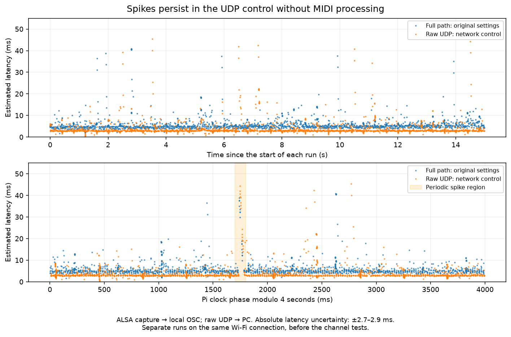

# Pi → OSCMidi latency and message interval errors — October 18, 2026

## Result

Delay spikes remain reproducible on the Wi-Fi link. None of the additional
settings tested during this investigation provides a sufficiently reliable
improvement to retain. The original PC, Pi firmware and router settings have
been restored. The removal of QoS markings previously shown to be harmful
remains in place: see the [RTP delivery measurements](rtp_delivery_2026-10-18.md).

In the final long run after restoration, **all 6 250 messages arrived in order**,
but one note reaches **97.34 ms**. Another long run, before the channel tests,
delivered **6 248/6 250 messages**, despite 6 250 events being received,
processed and handed to the MIDI output by the visualizer. The goals of
“no loss” and “no occasionally late notes” are therefore **not met on this
Wi-Fi connection**.

## Measurement

The generator injects a deterministic sequence into the visualizer's ALSA
input. OSCMidi receives RTP on its usual ports, then its existing OSC output
is timestamped on the PC when received over local UDP. This measurement includes
the visualizer, rtpmidid, the network and the RTP → OSC bridge. It excludes the
keyboard, physical USB transport and audio/ASIO/VST rendering.

A short run contains 750 groups spaced 20 ms apart: one note per group, a
six-note chord every twenty groups, release after 5 ms, for 1 880 messages.
Long runs use 2 500 groups and 6 250 messages. The Pi's counts and message
identity/order are checked before computing statistics. A sequence with lost,
duplicated or shifted messages is not silently realigned to produce good
percentiles.

The Pi and PC monotonic clocks are not assumed to be synchronized. Timestamped
UDP exchanges before and after each run bound their offset. Absolute latency
uses the midpoint of these bounds and linear interpolation; anchor uncertainty
is typically **±2.6 to ±2.9 ms**. Variable network asymmetry can appear as an
offset slope: this slope is not an independent measurement of clock drift.
A median difference of a few tenths of a millisecond therefore does not
demonstrate an optimization.

Interval error compares the gap between two arrivals with the gap between their
emissions. The constant clock offset cancels out; the small slope correction
retains the interpolation assumption. Chord spread also compares the spread at
emission and arrival.

## Comparable results

Every row below delivers exactly the expected count in order. Latencies are
estimates in milliseconds, with the uncertainty described above. The p99 is the
threshold below which 99% of the run's observations fall.

| Run | Messages | Median | p95 | p99 | Maximum | p99 of absolute interval error |
|---|---:|---:|---:|---:|---:|---:|
| Initial full path A | 1 880 | 4.79 | 9.44 | 23.78 | 39.05 | 10.84 |
| Initial full path B, USB reconnected | 1 880 | 5.11 | 10.74 | 19.01 | 40.87 | 11.67 |
| Raw UDP with unique identifiers | 1 880 | 2.97 | 8.11 | 21.97 | 45.35 | 13.11 |
| Direct synthetic RTP → OSCMidi | 1 880 | 3.11 | 7.71 | 26.59 | 46.41 | 10.79 |
| PC driver power saving disabled A | 1 880 | 4.81 | 9.65 | 16.27 | 46.53 | 13.11 |
| PC driver power saving disabled B | 1 880 | 4.81 | 9.91 | 21.81 | 48.82 | 14.70 |
| Manual router, channel 6, 20 MHz width, interface idle | 1 880 | 4.70 | 9.20 | 19.30 | 48.62 | 10.96 |
| Manual router, channel 11, 20 MHz width | 1 880 | 5.24 | 11.62 | 28.36 | 67.70 | 14.70 |
| Manual router, channel 1, 20 MHz width | 1 880 | 4.94 | 12.03 | 25.82 | 53.74 | 14.74 |
| Automatic router settings restored, long run | 6 250 | 4.81 | 9.36 | 19.00 | 97.34 | 10.82 |

In this final run, 44 messages exceed the median by more than 20 ms, six exceed
50 ms in absolute latency, and the maximum interval error reaches 90.85 ms.
The chords have a median arrival spread of 0.022 ms, a p99 of 7.61 ms and a
maximum of 8.24 ms. These spikes justify examining the distribution and interval
errors rather than just the mean.

The [structured results and plotted series](rtp_latency_2026-10-18.json) also
retain rejected tests. They contain no passwords.



The two plotted runs precede the channel tests. Several spikes concentrate
around the same phase of the Pi clock modulo four seconds, including with raw
UDP. Non-periodic spikes also occur. The observed phase is specific to this
session; it is not a constant to compensate for in MIDI code.

## Locating delays

The following checks require neither OSCMidi nor the PC's Wi-Fi: the Pi sends
pings to the router. These statistics are **ICMP round trips**, directly
comparable across these rows, rather than one-way MIDI latencies.

| Pi → router condition | Received / sent | Median RTT | p99 RTT | Maximum RTT |
|---|---:|---:|---:|---:|
| Initial configuration, visualizer active | 1 399 / 1 400 | 2.72 | 13.22 | 43.20 |
| Visualizer temporarily stopped | 1 400 / 1 400 | 1.99 | 14.91 | 46.40 |
| rtpmidid temporarily stopped | 1 400 / 1 400 | 2.74 | 19.54 | 98.00 |
| Firmware `mpc` temporarily disabled | 1 400 / 1 400 | 2.74 | 15.60 | 49.80 |
| Firmware `phy_watchdog` temporarily disabled | 1 400 / 1 401 | 2.73 | 16.31 | 45.60 |

Spikes at approximately four-second intervals persist while the visualizer and
rtpmidid are stopped. Their origin therefore does not require the visualizer's
Python processing or OSCMidi's RTP decoding. The remaining boundary includes
SDIO transfer, the Pi firmware/radio, medium access and the router. These tests
cannot conclusively distinguish among those components.

A separate kernel trace shows a handoff to the queue/driver on the order of
0.04–0.1 ms for some packets that arrive approximately 45–47 ms later on the PC.
The next entry into an SDIO worker proves neither transfer completion nor
successful radio transmission. The earlier capture at this stage also failed
the exact message check: it helps locate a boundary, not validate lossless
delivery or compute the published percentiles. The final UDP check uses unique
identifiers and passes.

NetworkManager queries station statistics approximately every six seconds in
the trace; no scan call is captured. This does not explain the regular
four-second spikes. The Pi's Bluetooth is inactive, Linux already reports
`Power save: off`, and the CPU governor is `performance`.

## Tests without a retained improvement and restoration

- The Windows streaming-mode and scan-suppression APIs did not provide a
  reproducible improvement. The no-scan test delivered 1 876/1 880 messages:
  failure. Their temporary requests were released.
- The Windows hardware setting `LowPowerEnable`, initially `Auto`, was tested
  on `Disabled`, then restored to `Auto`. The two runs above retain 47–49 ms
  spikes.
- `mpc` and `phy_watchdog` were each restored to their original value `1` after
  their bounded test. No permanent firmware modification is retained.
- The router's automatic 2.4 GHz selection was restored, with automatic channel
  and width settings. It again uses channel 6 at 20 MHz after restoration.
  The 5 GHz settings remain as before: channel `Auto`, 80 MHz width, advanced
  automatic selection disabled.
- The SSID, security, OSCMidi settings, plugin, audio and RTP ports 5004/5005
  are preserved. The OSCMidi configuration file is identical to the initial
  copy. Services stopped for the checks have restarted.

After a router channel change, `iw dev wlan0 link` retained a stale frequency.
The test channel was verified with `iw dev wlan0 info` and the firmware's
`chanspec` value rather than relying on that line alone.
One run interrupted by USB disconnection, an invalid clock calibration and
captures that fail the exact ordering check are excluded from the latency
tables. The 6 248/6 250 long test remains explicitly a delivery failure.

## Local recalculation and next steps

The analysis tool is separate from the production MIDI path. It rejects a
capture whose recorder has not confirmed exact message identity and order,
as well as incomplete production counts or reversed timestamps. This check
relies on the recorder's attestation: the offline tool does not itself repeat
network payload validation.

Using the maintenance captures retained locally:

```powershell
python scripts/analyze_midi_latency.py .maintenance/rtp-latency-baseline-usb-return-source.json .maintenance/rtp-latency-baseline-usb-return-raw.json
python -m pytest tests/test_midi_latency_analysis.py -q
```

Raw captures and injection scripts remain in `.maintenance/`, ignored by Git.
The published JSON retains each test's summary and the points used for the
plot; it does not replace a raw capture.

To attribute the remaining cause, the next discriminating test is an A/B/A
comparison with another Wi-Fi interface on the same access point, or with the
Pi on another access point. Neither was available during this session. The
router's alternative channels have already been tested without improvement.
A smoothing buffer would add delay to every note; it would fix neither these
transmission pauses nor the lost messages.
