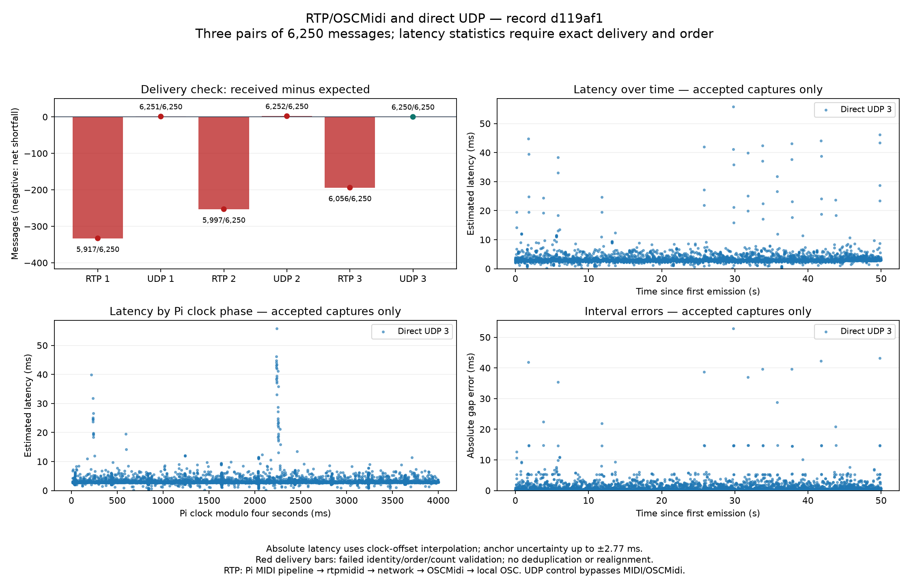

# Pi → RTP → OSCMidi and direct UDP — record d119af1

## Result

Delay spikes remain observable in the direct UDP control: the one strictly
valid long capture delivers 6,250/6,250 messages in order and reaches an
estimated **55.803 ms**, with clock-anchor uncertainty **±2.766 ms**.
Its maximum absolute interval error is **52.818 ms**.

All three full RTP/OSCMidi captures fail delivery validation. The Pi receives,
processes and hands 6,250 messages to its MIDI output in each run, while the PC
records 5,917, 5,997 and 6,056 OSC messages. These are net shortfalls of 333,
253 and 194 messages. No latency percentiles are published for those captures.
Two UDP controls also fail validation because of duplicate datagrams. No failed
capture was discarded, deduplicated or realigned to obtain latency statistics.

This establishes a current delay spike on the direct UDP path and delivery
failures on the full path. It does not provide a valid full-path RTP maximum
or identify whether the loss occurs in radio transmission, the access point,
PC networking or OSCMidi. A successful MIDI output call is not a radio-delivery
acknowledgement.

## Acquisition and boundaries

Record and tested runtime: `d119af1d30cffad1e8dfdd4ac590a31e938448d7`.
Acquisition: `2026-11-15T10:17:52.093169+00:00` to
`2026-11-15T10:25:25.528535+00:00`.
Pi Zero 2 W Rev 1.0, kernel `6.12.109+rpt-rpi-v7`, Python 3.11.2;
Windows PC with the already-running OSCMidi and a Python UDP recorder.

The Pi was fast-forwarded to the record version before capture. Runtime and
benchmark source files are unchanged from `bfbf93d`; the intervening commits
update measurement documentation and plotting tools. The visualizer and
rtpmidid services were not stopped. OSCMidi, router and Wi-Fi settings were
not changed by this campaign. This does not establish identical network
conditions or OSCMidi build versions to the historical acquisition.

Each run emits 2,500 groups on absolute 20 ms deadlines: one note per group,
six notes every twentieth group, releases after 5 ms, seed 1947. That gives
6,250 messages in approximately 50 seconds. Three pairs run in this order:
RTP 1, UDP 1, RTP 2, UDP 2, RTP 3, UDP 3. After the first failed RTP capture,
the campaign paused to inspect the failure, then resumed the remaining planned
runs. Two short 16-message setup checks passed beforehand and are excluded
from the long-run statistics.

The independent source runs on CPU 3 at nice 0; the production runtime runs on
CPU 2 at nice −10. There is no cProfile or GC/canary stall monitor. The source
timestamps immediately before `Mido.send` or `socket.sendto`; this boundary
starts at actual emission, unlike the planned-emission boundary in the
[LED A/B benchmark](pipeline_8bb30e7.md).

The full path includes virtual ALSA input, the production MIDI pipeline,
rtpmidid, network transport, OSCMidi decoding and reception of its local OSC
datagram on the PC. The UDP control bypasses the MIDI pipeline and OSCMidi;
the production services remain running. PC timestamps are taken after
`recvfrom`. These results exclude keyboard scanning, physical USB transport,
audio/VST rendering and light output.

## Delivery checks

| Run | Source events | Pi receive / process / output calls | PC messages | Net difference | Strict result |
| --- | ---: | --- | ---: | ---: | --- |
| RTP 1 | 6,250 | 6,250 / 6,250 / 6,250 | 5,917 | −333 | Failed: incomplete sequence |
| UDP 1 | 6,250 | Bypassed | 6,251 | +1 | Failed: one duplicate, all expected IDs present |
| RTP 2 | 6,250 | 6,250 / 6,250 / 6,250 | 5,997 | −253 | Failed: incomplete sequence |
| UDP 2 | 6,250 | Bypassed | 6,252 | +2 | Failed: two duplicates, all expected IDs present |
| RTP 3 | 6,250 | 6,250 / 6,250 / 6,250 | 6,056 | −194 | Failed: incomplete sequence |
| UDP 3 | 6,250 | Bypassed | 6,250 | 0 | Passed: exact identity, order and hash |

The RTP net shortfalls are 5.33%, 4.05% and 3.10% of emitted messages.
No software MIDI send errors are recorded, and the Pi queues drain after every
run. These counters locate the discrepancy after the instrumented output
handoff; they do not distinguish network loss from loss in the PC bridge or
recorder. The counts are messages, not captured RTP packet counts.

The expected OSC payload sequence is derived from the synthetic MIDI events.
Its hash is compared with the actual PC OSC payload sequence. The UDP control
also carries unique sequential IDs. The recorder requires exact identity,
order and count before calculating latency; matching only totals is insufficient.

## Valid latency observation

Only UDP 3 passes strict validation. All values below are milliseconds and
describe this single run, not pooled statistics or a performance guarantee.

| Measurement | Median | Mean | p95 | p99 | Maximum |
| --- | ---: | ---: | ---: | ---: | ---: |
| Estimated direct UDP latency | 2.928 | 3.353 | 5.349 | 9.612 | 55.803 |
| Absolute interval error | 0.169 | 0.738 | 2.941 | 5.753 | 52.818 |

The Pi and PC monotonic clocks are calibrated with 35 UDP exchange attempts
before and after each run. The narrowest successful exchange bounds the clock
offset at each anchor; the midpoint is interpolated between anchors. Raw
exchanges, successful sample counts and uncertainty are retained. Network
asymmetry can affect the fitted offset slope; it is not a separate measurement
of clock drift. Constant clock offset cancels in interval errors, while the
small slope correction retains the interpolation assumption.



Only UDP 3 appears in the timing panels. Several peaks concentrate near the
same Pi clock phase when folded modulo four seconds, with additional isolated
peaks elsewhere. The phase is specific to this acquisition and must not be
used as a fixed timing correction. Observing the spike with direct UDP shows
that this measurement does not require MIDI processing or OSCMidi decoding;
it does not isolate the radio, driver, router or receiver scheduling as its cause.

The [historical record 9aa05ea](rtp_latency_9aa05ea.md) remains separate.
Its lossless long RTP capture and the present failed RTP captures are not a
controlled before/after comparison of software versions.

## Data, recalculation and final state

The [JSON report](rtp_latency_d119af1.json) contains all six run summaries.
The [compressed captures](rtp_latency_d119af1_captures.json.gz) retain synthetic
source events, received OSC/UDP payloads, arrival timestamps and clock exchanges,
including the rejected runs. They omit credentials, host/IP/MAC identifiers,
MIDI port identities, saved configuration hashes and private API snapshots.
Every published payload was checked against the synthetic workload's allowed
messages. Original connection details and API captures remain private.

The [plotting and validation tool](../../tools/plot_rtp_measurements.py) reconstructs
expected payloads, verifies hashes and order, recalculates clock anchors, and
recomputes valid statistics before plotting. With Matplotlib installed on a
workstation, from the repository root:

```bash
python tools/plot_rtp_measurements.py Docs/measurements/rtp_latency_d119af1.json --output Docs/assets/rtp_latency_d119af1.png
```

Omit `--output` to validate without Matplotlib. The published image uses
Matplotlib 3.11.2. No new runtime dependency is required on the Pi.

After capture, note-off cleanup sweeps are sent outside the measured windows.
The visualizer and rtpmidid services are active, the RTP peer is ready, all
reported MIDI queues are empty and the saved configuration checksum is
unchanged. Final Pi temperature is 45.1 °C with `throttled=0x0`.
The remaining loss and delay mechanisms need further discrimination; these
captures do not establish loss-free production delivery.
