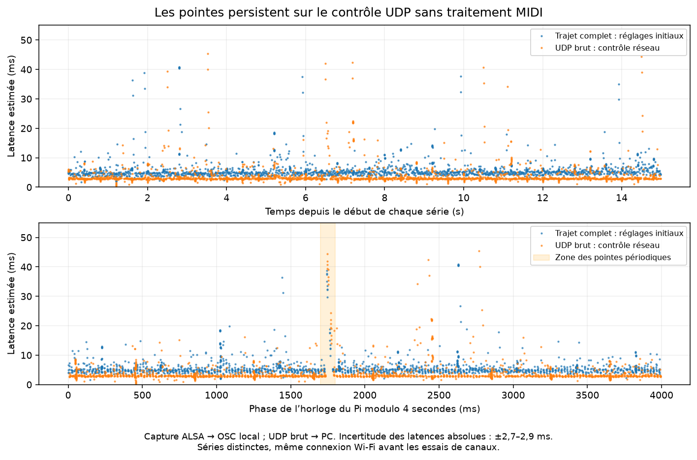

# Latence et écarts entre messages Pi → OSCMidi — 18 octobre 2026

## Résultat

Les pointes de retard restent reproductibles sur le lien Wi-Fi. Aucun réglage
supplémentaire testé pendant cette investigation n'apporte de gain suffisamment
fiable pour être conservé. Les réglages initiaux du PC, du firmware du Pi et de
la box ont été rétablis. La suppression des marquages QoS précédemment démontrés
comme nuisibles reste en place : voir [l'investigation des pertes RTP](rtp_loss_origin_2026-10-18.md).

Sur la dernière série longue après restauration, les **6 250 messages sont
arrivés dans l'ordre**, mais une note atteint **97,34 ms**. Une autre série longue,
avant les essais de canaux, a livré **6 248/6 250 messages**, malgré 6 250 événements
reçus, traités et remis à la sortie MIDI par le visualizer. Les objectifs
« aucune perte » et « aucune note occasionnellement tardive » ne sont donc
**pas atteints sur cette connexion Wi-Fi**.

## Mesure

Le générateur injecte une séquence déterministe dans l'entrée ALSA du visualizer.
OSCMidi reçoit le RTP sur ses ports habituels, puis son émission OSC existante
est horodatée sur le PC, à la réception UDP locale. Cette mesure comprend le
visualizer, rtpmidid, le réseau et le pont RTP → OSC. Elle exclut le clavier,
le transport USB physique et le rendu audio/ASIO/VST.

Une série courte contient 750 groupes espacés de 20 ms : une note par groupe,
un accord de six notes tous les vingt groupes, relâchement après 5 ms, soit
1 880 messages. Les séries longues utilisent 2 500 groupes et 6 250 messages.
Les compteurs du Pi et l'identité/l'ordre des messages sont contrôlés avant
de calculer les statistiques. Une série perdue, dupliquée ou décalée n'est pas
réalignée silencieusement pour produire de bons percentiles.

Les horloges monotones du Pi et du PC ne sont pas supposées synchronisées.
Des échanges UDP horodatés avant et après chaque série bornent leur décalage.
La latence absolue utilise le milieu de ces bornes et une interpolation linéaire ;
l'incertitude des ancrages est typiquement **±2,6 à ±2,9 ms**. Une asymétrie réseau
variable peut apparaître comme une pente du décalage : cette pente n'est pas une
mesure indépendante de la dérive des horloges. Une différence de médiane de
quelques dixièmes de milliseconde ne démontre donc pas une optimisation.

L'erreur d'intervalle compare l'écart entre deux arrivées à l'écart entre leurs
émissions. Le décalage constant des horloges s'annule ; la petite correction de
pente conserve l'hypothèse d'interpolation. La dispersion des accords compare
aussi leur étalement à l'émission et à l'arrivée.

## Résultats comparables

Toutes les lignes ci-dessous livrent exactement le nombre attendu dans l'ordre.
Les latences sont des estimations en millisecondes, avec l'incertitude ci-dessus.
Le p99 est le seuil sous lequel se trouvent 99 % des observations de la série.

| Série | Messages | Médiane | p95 | p99 | Maximum | p99 de l'erreur absolue d'intervalle |
|---|---:|---:|---:|---:|---:|---:|
| Trajet complet initial A | 1 880 | 4,79 | 9,44 | 23,78 | 39,05 | 10,84 |
| Trajet complet initial B, USB reconnecté | 1 880 | 5,11 | 10,74 | 19,01 | 40,87 | 11,67 |
| UDP brut avec identifiants uniques | 1 880 | 2,97 | 8,11 | 21,97 | 45,35 | 13,11 |
| RTP synthétique direct → OSCMidi | 1 880 | 3,11 | 7,71 | 26,59 | 46,41 | 10,79 |
| Économie d'énergie du pilote PC désactivée A | 1 880 | 4,81 | 9,65 | 16,27 | 46,53 | 13,11 |
| Économie d'énergie du pilote PC désactivée B | 1 880 | 4,81 | 9,91 | 21,81 | 48,82 | 14,70 |
| Box manuelle, canal 6, largeur 20 MHz, interface au repos | 1 880 | 4,70 | 9,20 | 19,30 | 48,62 | 10,96 |
| Box manuelle, canal 11, largeur 20 MHz | 1 880 | 5,24 | 11,62 | 28,36 | 67,70 | 14,70 |
| Box manuelle, canal 1, largeur 20 MHz | 1 880 | 4,94 | 12,03 | 25,82 | 53,74 | 14,74 |
| Box automatique rétablie, série longue | 6 250 | 4,81 | 9,36 | 19,00 | 97,34 | 10,82 |

Sur cette dernière série, 44 messages dépassent la médiane de plus de 20 ms,
six dépassent 50 ms en latence absolue, et l'erreur maximale d'intervalle
atteint 90,85 ms. Les accords ont une dispersion d'arrivée médiane de 0,022 ms,
un p99 de 7,61 ms et un maximum de 8,24 ms. Ces pointes justifient de regarder
la distribution et les écarts plutôt que la seule moyenne.

Les [résultats structurés et les séries du graphique](measurements/rtp_latency_2026-10-18.json)
conservent aussi les essais rejetés. Ils ne contiennent aucun mot de passe.



Les deux séries du graphique précèdent les essais de canaux. Plusieurs pointes
se concentrent autour de la même phase de l'horloge du Pi modulo quatre secondes,
y compris sur UDP brut. Il existe aussi des pointes non périodiques. La phase
observée est propre à cette session ; elle ne constitue pas une constante à
compenser dans le code MIDI.

## Localisation des retards

Les contrôles suivants ne nécessitent ni OSCMidi, ni le Wi-Fi du PC : le Pi
envoie des pings à la box. Les statistiques sont des **allers-retours ICMP**,
directement comparables entre ces lignes, et non des latences MIDI aller simple.

| Condition Pi → box | Reçus / émis | Médiane RTT | p99 RTT | Maximum RTT |
|---|---:|---:|---:|---:|
| Configuration initiale, visualizer actif | 1 399 / 1 400 | 2,72 | 13,22 | 43,20 |
| Visualizer temporairement arrêté | 1 400 / 1 400 | 1,99 | 14,91 | 46,40 |
| rtpmidid temporairement arrêté | 1 400 / 1 400 | 2,74 | 19,54 | 98,00 |
| Firmware `mpc` temporairement désactivé | 1 400 / 1 400 | 2,74 | 15,60 | 49,80 |
| Firmware `phy_watchdog` temporairement désactivé | 1 400 / 1 401 | 2,73 | 16,31 | 45,60 |

Les pointes au rythme d'environ quatre secondes persistent pendant les arrêts
du visualizer et de rtpmidid. Leur origine ne nécessite donc pas le traitement
Python du visualizer ou le décodage RTP d'OSCMidi. La frontière restante comprend
la transmission SDIO, le firmware/radio du Pi, l'accès au médium et la box.
Ces tests ne permettent pas de départager définitivement ces composants.

Une trace noyau séparée montre une remise à la file/pilote de l'ordre de
0,04–0,1 ms pour certains paquets qui arrivent environ 45–47 ms plus tard au PC.
L'entrée suivante dans un worker SDIO n'est pas une preuve d'achèvement du
transfert, ni de transmission radio réussie. L'ancienne capture à ce stade a
par ailleurs échoué au contrôle exact des messages : elle sert à localiser
une frontière, pas à valider l'absence de pertes ou à calculer les percentiles
publiés. Le contrôle UDP final emploie des identifiants uniques et passe.

NetworkManager interroge les statistiques de station environ toutes les six
secondes dans la trace ; aucun appel de scan n'y est capturé. Cela n'explique
pas les pointes régulières à quatre secondes. Le Bluetooth du Pi est inactif,
Linux annonce déjà `Power save: off`, et le gouverneur CPU est `performance`.

## Essais sans gain retenu et restauration

- Les API Windows de mode streaming et de suspension des scans n'ont pas fourni
  de gain reproductible. L'essai sans scan a livré 1 876/1 880 messages : échec.
  Leurs demandes temporaires ont été libérées.
- Le réglage matériel Windows `LowPowerEnable`, initialement `Auto`, a été testé
  sur `Disabled`, puis rétabli sur `Auto`. Les deux séries ci-dessus conservent
  des pointes de 47–49 ms.
- `mpc` et `phy_watchdog` ont chacun été rétablis à leur valeur initiale `1`
  après leur essai borné. Aucune modification permanente du firmware n'est gardée.
- La box a retrouvé la sélection automatique 2,4 GHz, canal et largeur configurés
  en automatique. Elle utilise de nouveau le canal 6 en 20 MHz après restauration.
  Le 5 GHz reste configuré comme avant : canal `Auto`, largeur 80 MHz,
  mécanisme de sélection automatique avancé désactivé.
- Le SSID, la sécurité, les paramètres OSCMidi, le plugin, l'audio et les ports
  RTP 5004/5005 sont conservés. Le fichier de configuration OSCMidi est identique
  à la copie initiale. Les services arrêtés pour les contrôles ont redémarré.

Après un changement de canal par la box, `iw dev wlan0 link` a conservé une
fréquence périmée. Le canal d'essai a été vérifié avec `iw dev wlan0 info` et
la valeur `chanspec` retournée par le firmware, plutôt qu'avec cette seule ligne.

Une série interrompue par le débranchement USB, une calibration d'horloge
invalide et les captures dont l'ordre exact échoue sont exclues des tableaux
de latence. Le test long à 6 248/6 250 reste explicitement un échec de livraison.

## Recalcul local et suites

L'outil d'analyse est séparé du trajet MIDI de production. Il refuse une capture
dont l'enregistreur n'a pas confirmé l'identité et l'ordre exacts des messages,
ainsi que des compteurs de production incomplets ou des horodatages inversés.
Ce contrôle se fonde sur l'attestation de l'enregistreur : l'outil hors ligne
ne refait pas lui-même la validation des charges utiles réseau.

Avec les captures de maintenance conservées localement :

```powershell
python scripts/analyze_midi_latency.py .maintenance/rtp-latency-baseline-usb-return-source.json .maintenance/rtp-latency-baseline-usb-return-raw.json
python -m pytest tests/test_midi_latency_analysis.py -q
```

Les captures brutes et les scripts d'injection restent dans `.maintenance/`,
ignoré par Git. Le fichier JSON publié conserve les résumés de chaque essai et
les points utilisés pour le graphique ; il ne remplace pas une capture brute.

Pour attribuer la cause restante, le prochain essai discriminant est un A/B/A
avec une autre interface Wi-Fi sur le même point d'accès, ou avec le Pi sur un
autre point d'accès. Aucun de ces matériels n'était disponible pendant cette
session. Les canaux alternatifs de la box ont déjà été testés sans gain.
Un buffer de lissage ajouterait du délai à toutes les notes ; il ne corrigerait
ni ces pauses de transmission, ni les messages perdus.
